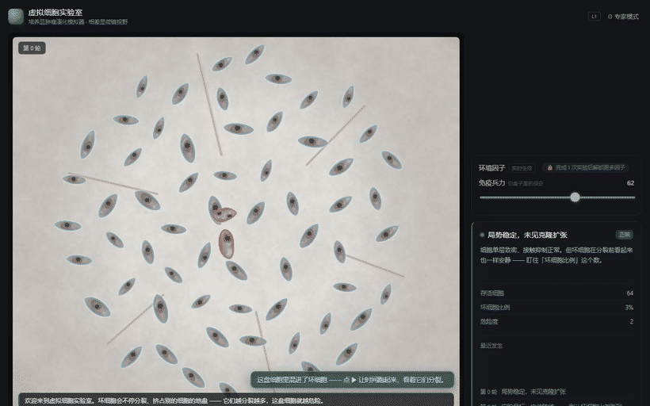
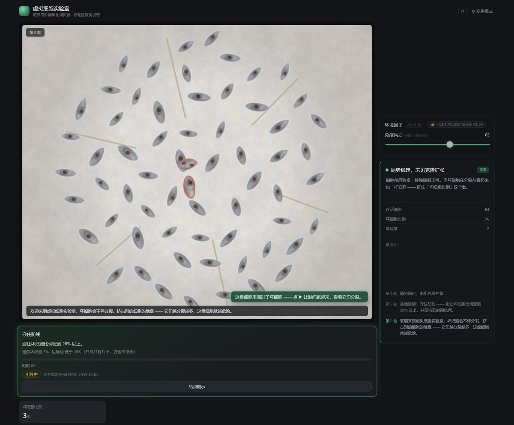
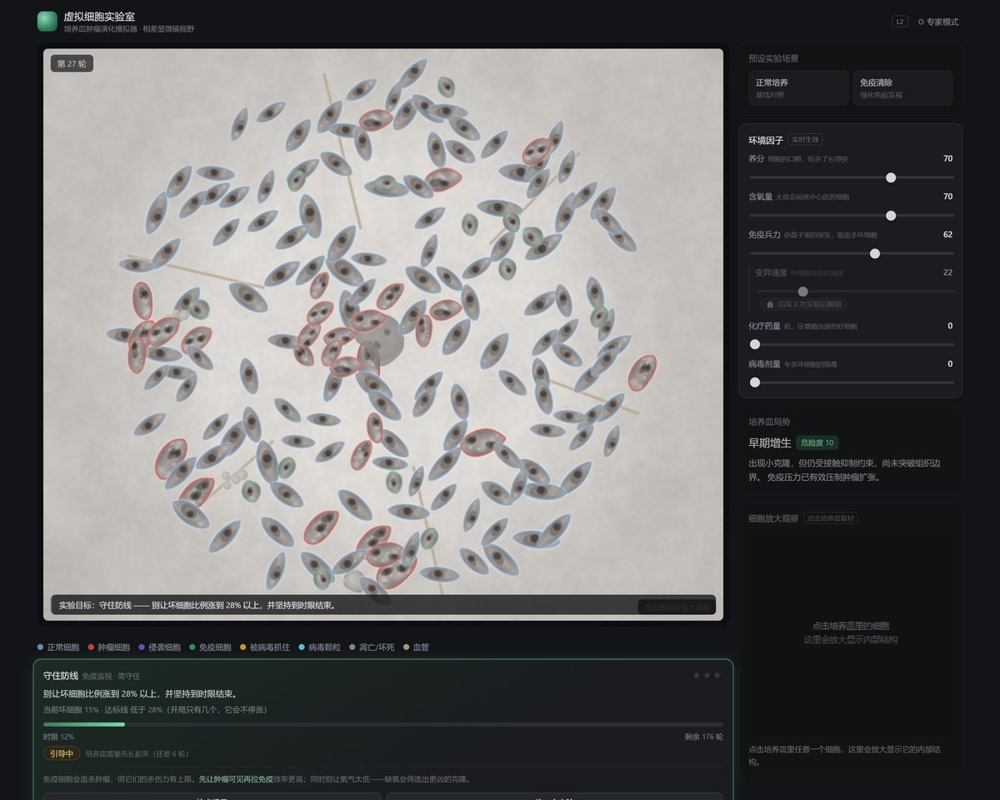
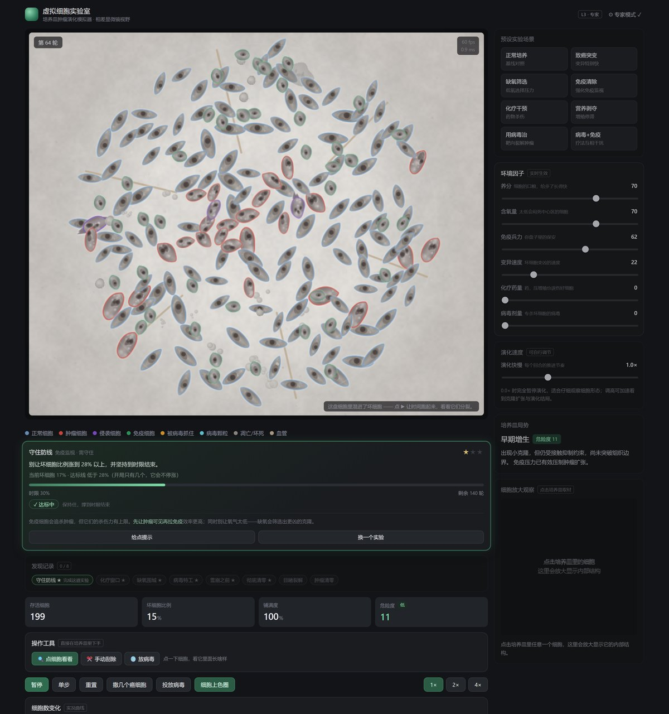

# 虚拟细胞实验室 · Virtual Cell Lab

> 一个**零依赖**的交互式肿瘤微环境演化模拟器 —— 把一张会呼吸的培养皿装进浏览器。
>
> An interactive, dependency-free tumor microenvironment simulator running entirely in your browser.

> ### ▶ [**在线体验 / Live Demo**](https://zhouboyu0217.github.io/virtual-cell-lab/)
> 不用下载、不用安装，点开就能玩。



<sub>▲ 6 秒实录：第 0 轮 64 个细胞 → 第 76 轮 217 个。拖动「免疫兵力」到 80 后，绿色免疫细胞贴上去清除坏细胞，右侧状态卡与事件流同步记录因果。</sub>



**不用安装任何东西**：双击 `index.html` 就能跑。没有 npm，没有框架，没有 CDN，没有构建步骤。

---

## 这是什么

想象一台显微镜，但里面的细胞不只在动 —— 它们会**分裂、争夺空间、在缺氧处坏死、被免疫细胞追杀、被病毒撑爆、在化疗下筛选出更凶的克隆**。你手里有六根旋钮，可以随时改写这个世界的物理法则。

这个项目把**肿瘤微环境的五条核心机制**翻译成了可执行的代码，并做成一个能上手玩的实验台：

| 生物学机制 | 代码里的实现 |
|---|---|
| **接触抑制失效** | 邻域密度查询 → 增殖概率衰减（密度越高越难分裂） |
| **缺氧筛选** | 局部氧浓度场按到皿心距离衰减 → 低于阈值触发坏死，存活者向侵袭表型漂移 |
| **免疫监视** | 免疫细胞趋化追踪 → 接触杀伤 → 肿瘤比例下降 |
| **溶瘤病毒** | 感染 → 胞内载量累积 → 阈值触发裂解 → 释放子代病毒扩散 |
| **化疗选择压** | 按危险度加权杀伤 → 高增殖克隆被淘汰 → 耐受克隆富集 |

**它不是动画，是模拟。** 每一个细胞都是带状态机的空间智能体，在离散时间步上跑同一套耦合规则。

---

## 快速开始

```bash
# 方式零：打开浏览器（最快）
# https://zhouboyu0217.github.io/virtual-cell-lab/

# 方式一：直接双击（最简单）
index.html

# 方式二：起个本地服务器（推荐，避免个别浏览器的 file:// 限制）
python -m http.server 8000
# 然后访问 http://localhost:8000
```

**环境要求**：任意现代浏览器（Chrome / Edge / Firefox / Safari）。无 Node.js、无 Python 依赖。

**第一次打开会进入引导模式**（Tier 1）：屏幕上只有 3 个可操作控件和一句话"点 ▶ 让时间跑起来"。
不想走引导？点右上角 **`⚙ 专家模式`**，一键解锁全部面板。

---

## 三层渐进式引导

交互式模拟系统最常见的死法，是**第一屏就把所有旋钮推给新人**。本项目把复杂度做成了三层，按玩家行为动态释放 —— 可操作控件从 **29 个降到 3 个起步**。

| 层级 | 面向 | 界面呈现 |
|---|---|---|
| **Tier 1 · 30 秒上手** | 任何人 | 培养皿 + 一根「免疫兵力」滑块 + 播放键。目标一句话说清 |
| **Tier 2 · 探索** | 想玩的人 | 逐步释放因子、工具、曲线、局势面板 |
| **Tier 3 · 精通** | 研究者 | 全量 29 个控件、八组预设、完整指标 |

三套机制**正交**工作，这是本项目的核心设计洞察 —— **"可见" ≠ "同权重"**：

- **可见性**由事件驱动（完成实验数 / 触碰因子数），不由时间决定
- **视觉权重**是持久的：即使全解锁，次要面板仍长期压暗，培养皿始终是唯一亮块
- **入场动画**只在解锁那一帧播一次，把"解锁"本身变成奖励




---

## 玩法

### 六道实验任务

每道题都埋了一个**真实的生物学矛盾**，不是单纯的数值挑战：

| 任务 | 目标 | 核心张力 |
|---|---|---|
| **守住防线** | 坏细胞比例不超过 28%，坚持到时限 | 入门题。开局低是正常的，要防的是上涨 |
| **化疗窗口** | 压到 20% 以下，同时保住 55% 正常细胞 | 化疗是双刃剑，治疗窗很窄 |
| **缺氧围城** | 含氧量锁 30，危险度控制 50 以内 | 低氧抑制生长的同时筛选出更凶的克隆 |
| **病毒特工** | 病毒剂量压制到 30% 以下，正常细胞不低于 50% | 病毒精准杀瘤，但免疫会连病毒一起清除 |
| **雪崩之前** | 变异速度锁 85，120 轮内压到 40% 以下 | 压得越狠，筛出的克隆越强，比的是速度 |
| **彻底清零** | 让存活细胞降到 15 以下 | 清空培养皿 —— 但先想清楚：这算成功吗？ |

### 三种操作工具

- **点细胞看看** — 点选任意细胞，右侧放大观察其内部结构
- **手动删除** — 按住拖动，模拟机械刮除造成的损伤
- **投放病毒** — 在指定位置接种溶瘤病毒，看它向周围扩散的路径

### 八个预设场景与八个里程碑

预设覆盖「正常培养 / 致癌突变 / 缺氧筛选 / 免疫清除 / 化疗干预 / 营养剥夺 / 用病毒治 / 病毒+免疫」；里程碑包括六道任务通关，以及「目睹裂解」「肿瘤清零」两个彩蛋。

---

## 技术亮点

### 1. 相衬显微镜渲染（`phaseContrast`）

不做卡通化的圆形色块，而是**模拟光学成像**：按细胞的光学厚度计算亮度，再做低频分量分离产生边缘光晕 —— 在二维画布上复现相差显微镜的质感。细胞核、胞质、边缘的明暗关系来自物理近似，不是手绘贴图。

### 2. 空间哈希网格

邻域查询（增殖抑制、免疫接触、病毒传播）若暴力遍历是 O(n²)。用均匀网格把细胞按位置分桶后，邻域查询降到近似 O(n) —— 这是 400 细胞量级仍能实时演化的前提。

### 3. 时间归一化插值

这是一个**容易被忽略的真 bug 级别问题**：动画若写成"每帧位移 17%"，在 60 Hz 屏上正常，但在 120/144 Hz 屏上帧数翻倍 → **整套动画快 2~2.4 倍**。本项目用

```js
rt(k) = 1 - (1 - k) ^ (dt / 16.667)
```

对剩余量做相同时长的指数衰减，数学上保证 60 Hz 一帧与 120 Hz 两帧进展完全相等。60 Hz 下数值与原实现逐位一致，零观感回归。

配套细节：帧间隔钳制在 `[0, 2.5]` 防切标签页后瞬跳；同帧系数记忆化缓存 + 60 Hz 快速路径，避免每帧数千次 `Math.pow`。

### 4. 三层渐进复杂度揭示

见上文。核心是「可见性 / 视觉权重 / 入场节奏」三套正交机制，而非简单的时间窗分段。

---

## 目录结构

```
virtual-cell-lab/
├── index.html                 # 主程序（4634 行，单文件，零依赖）
├── README.md
├── LICENSE
├── design/                    # 设计文档（约 2900 行）
│   ├── README.md              #   设计资产索引
│   ├── gdd/
│   │   ├── onboarding-design.md   # 三层引导系统设计（1475 行）
│   │   └── guide-v2.md            # 新手引导脚本设计（295 行）
│   └── art/
│       ├── visual-hierarchy.md    # 视觉层级与权重体系（1080 行）
│       ├── polish-spec.md         # 配色与简洁度规格（537 行）
│       └── status-block-spec.md   # 状态区块规格（430 行）
├── tests/                     # 自动化验收套件
│   ├── qa-plan.md             #   验收方案
│   ├── run-all.js             #   一键总运行器
│   ├── verify-*.js            #   各项验收脚本
│   └── verification-report.md #   验收报告
└── docs/
    └── screenshots/
```

---

## 测试

验收套件基于 [Playwright](https://playwright.dev/)，覆盖 14 项验收标准（含 Storage 异常降级、术语一致性、数值平衡、层级跃迁可达性等）。

```bash
cd tests
npm install          # 安装 playwright
node run-all.js      # 一键运行，输出 verification-report.md
```

**重点验收项**：

| 项 | 验什么 |
|---|---|
| **A8** | `localStorage` 被禁用/抛异常/存档损坏时**不白屏**（单个 IIFE 内任何未捕获异常都会导致永久转圈） |
| **A9** | 术语一致性 —— 玩家可见文本零专业术语残留，同时**注释未被误改** |
| **A10** | 数值平衡未被改动 —— 任务判据、环境参数、关键常量字节级一致 |
| **A11** | 两条层级跃迁路径**均可达**（防止引导卡死） |

---

## 设计文档

`design/` 下的三份文档不是事后补的说明书，而是**先写文档、再写代码**的产物：

- **`onboarding-design.md`** — 三层引导的完整状态机、解锁触发条件、术语通俗化映射表、L1 前三步逐字文案
- **`visual-hierarchy.md`** — 视觉权重的量化体系（边框可见度 3.20 / 1.25 / 1.12 三档梯度）、焦点手法参数、解锁动效时间轴
- **`polish-spec.md`** — 配色实测 WCAG 对比度、4px 间距网格、暗色卡片的内高光参数

---

## 已知限制

诚实比漂亮重要，这个模拟器有几处明确的简化：

1. **二维近似** — 真实肿瘤是三维结构，本模型的"缺氧"只按到皿心距离衰减，未考虑血管分布与灌注异质性。
2. **无时间尺度标定** — 一个"回合"不对应真实生物学时间，参数是相对量而非物理量。
3. **免疫模型高度简化** — 只有趋化与接触杀伤，没有抗原呈递、免疫检查点、T 细胞耗竭等机制。
4. **无空间位移的被动扩散** — 病毒颗粒做布朗漂移，不模拟流体动力学。

因此它适合**机制教学与直觉培养**，不适合做定量预测或药物剂量推算。

---

## 许可

[MIT License](LICENSE) —— 随便用，随便改，随便讲给别人听。

---

<p align="center">
  <i>「你动因子，看比例 —— 这就是这盘细胞的读法。」</i>
</p>
